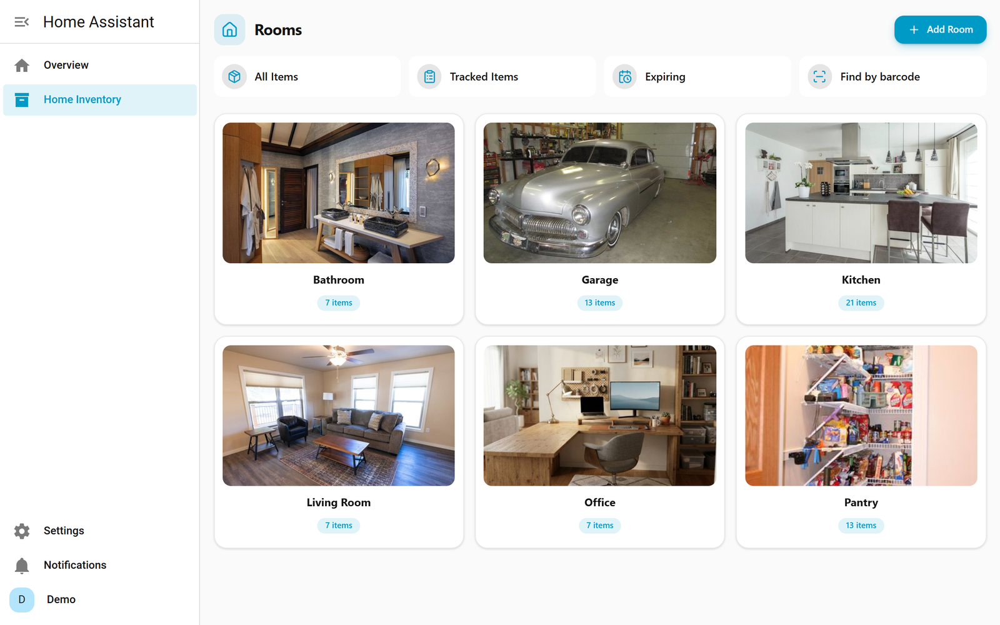
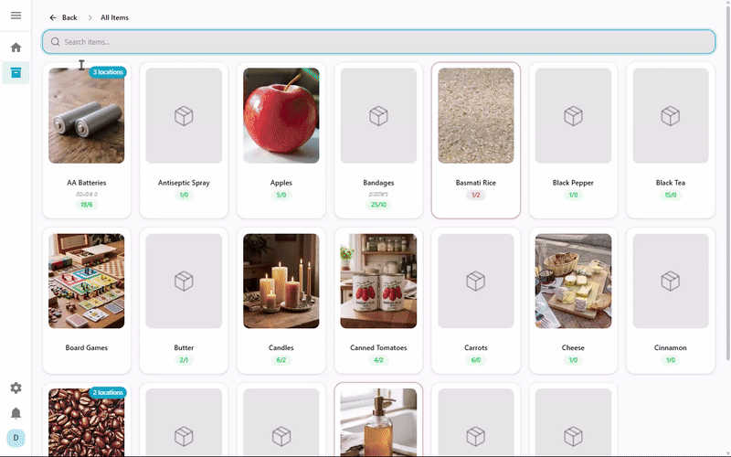
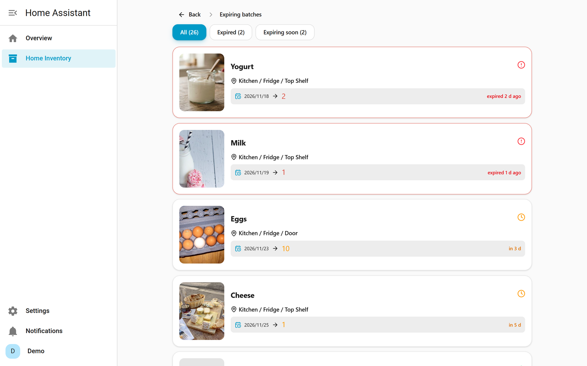
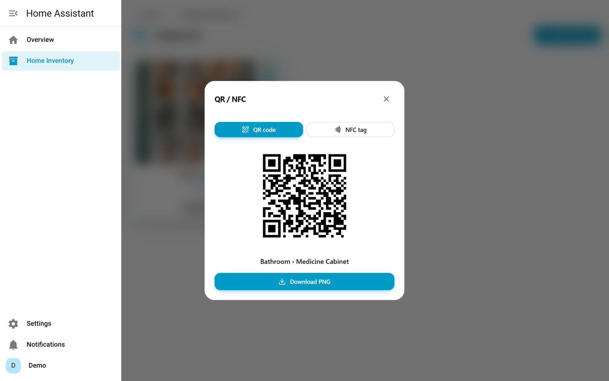
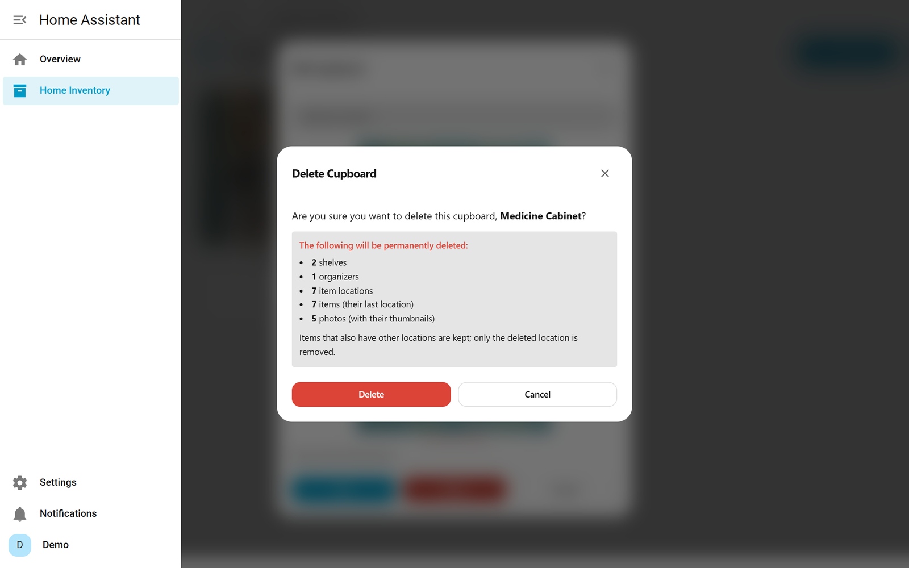
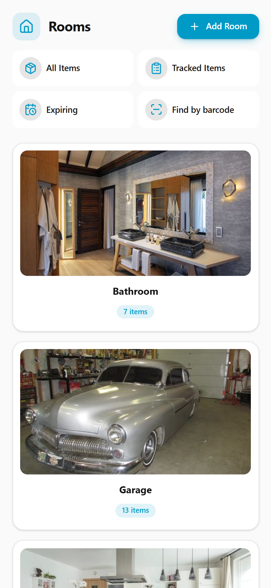
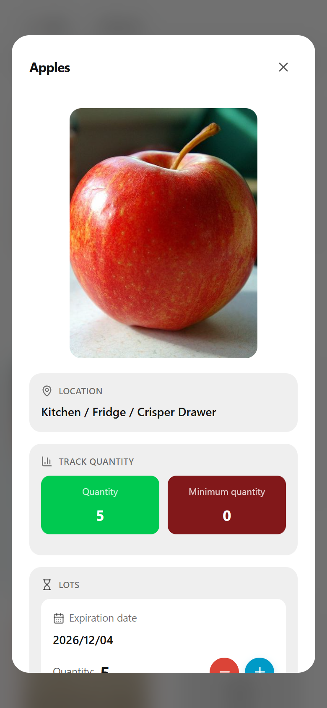
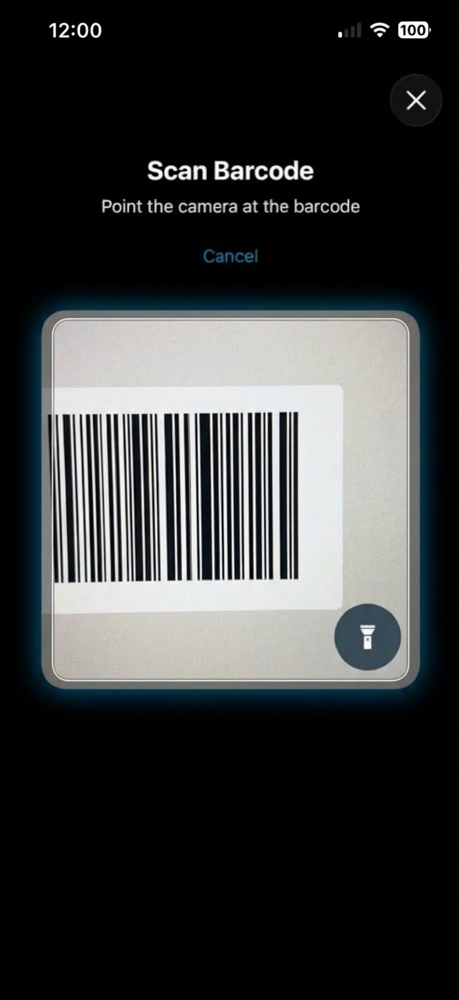
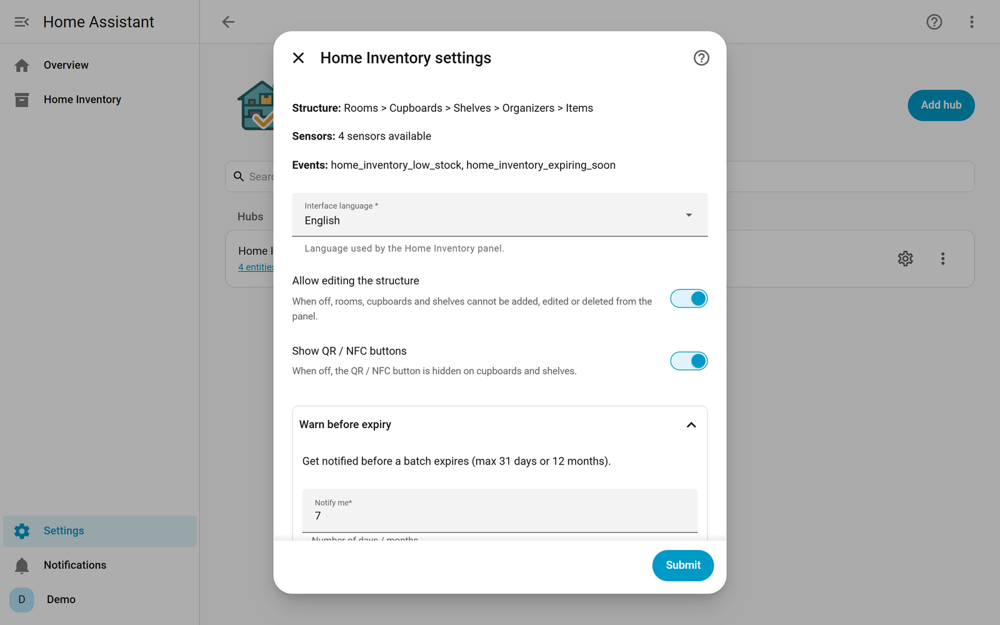
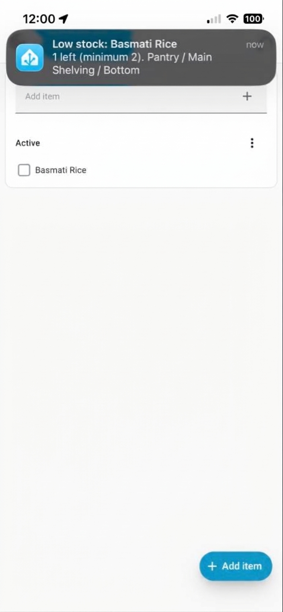

<p align="center">
  
</p>

<h3 align="center">Remember where you put things, and what is about to expire, without leaving Home Assistant.</h3>

<div align="center">


[](https://my.home-assistant.io/redirect/hacs_repository/?owner=SnipsC0&repository=Home-Inventory&category=integration)

</div>

<p align="center">
  
</p>

Things you don't use often are the ones you lose: the spare light bulbs, the soldering iron, the winter blanket, the batteries you know you bought. A year later you can't remember which cupboard or box they went into, so you search the whole house or buy them again.

Things that expire are worse. The medicine cabinet fills up quietly, and you usually find out the aspirin expired at the moment you need it.

This is meant to be the place you check first. Write down where something lives once, and next time you just search for it instead of opening every drawer. Add the expiry date to the aspirin and Home Assistant tells you a week before it goes bad, while there's still time to buy a new box. And since the same item can be in more than one place, with a count for each, you also stop buying a fourth pack of batteries when three are already in the hallway drawer.

Every level (room, cupboard, shelf, organizer) can have a photo, so you can also see where things are, not just read it.

Everything stays on your Home Assistant box. Low stock and expiry show up as sensors and events, so you can hook them into your own automations.

---

<details>
<summary>Tips</summary>

**Start small**<br>
Do one room, or even one cupboard, before you try to catalogue the whole house. Add the structure first (room, cupboard, shelf), then the items. Once the first cupboard works the way you like, the rest goes quickly.

**Use organizers for boxes and drawers**<br>
If a shelf holds a few boxes, make each box an organizer. "Third shelf, blue box" is much easier to find than "somewhere in the garage".

**Take a photo, even a bad one**<br>
A picture of the shelf or the box is often faster than a description, and it helps when two things have similar names. Photos on items are optional, but they make search results much easier to scan.

**Track quantity only where it matters**<br>
Batteries, coffee filters and light bulbs are worth it. A hammer is not. For tracked items, set a minimum you would really restock at. The low stock alert fires when the total across all places drops to it, so it will not nag you while the spare is in another cupboard.

**Add aliases**<br>
If you call it "the drill" but the label says "cordless screwdriver", add both names so either one finds it.

**Use variants for sizes and brands**<br>
A 500 g and a 1 kg jar of honey are the same item with two variants. Each gets its own quantity and its own barcode, and scanning either one opens the right row.

**Put expiry dates on medicine first**<br>
Food usually gets eaten before it expires, medicine does not. Go through the medicine cabinet once, add the dates from the boxes, and let the warning window (7 days by default, adjustable in the options) do the remembering. Add partly used packs as separate batches if their dates differ.

**Label the furniture you open most**<br>
A QR code or an NFC tag on the cupboard door takes you straight to what is inside, without browsing through rooms. Print the QR code from the QR / NFC dialog, or write the link to a cheap NFC sticker.

**Let Home Assistant do the nagging**<br>
Send low stock to a shopping list and expiring items to your phone (see the [automation examples](https://github.com/SnipsC0/Home-Inventory/blob/main/docs/automations.md)). Then you only open the panel when you need to look something up.

**Check the delete preview**<br>
Deleting a cupboard removes its shelves, items and photos too. The preview lists all of it before you confirm.

</details>

---

## Features

<table>
<tr>
<td width="40%" valign="middle">

### Browse your home

Start at a room, open a cupboard, then a shelf, and you're looking at the item. Every card has a photo, and tracked items have quick +/- buttons and a minimum quantity.

</td>
<td width="60%">

<picture>
  <source media="(prefers-color-scheme: dark)" srcset="https://raw.githubusercontent.com/SnipsC0/Home-Inventory/main/docs/assets/screenshots/01-rooms-dark.png">
  
</picture>

</td>
</tr>
</table>

<table>
<tr>
<td width="60%">



</td>
<td width="40%" valign="middle">

### One item, many places

Batteries in three drawers? Olive oil in the pantry and in the kitchen? Add the item once and give each place its own quantity, expiry dates and photo. Variants like a small jar vs. a big one get their own row and their own barcode.

</td>
</tr>
</table>

<table>
<tr>
<td width="40%" valign="middle">

### Never throw food away

Add expiry dates per batch and pick how early you want a warning (days or months). The **Expiring** view lists what's about to go off, and a sensor plus an event let you get a notification.

</td>
<td width="60%">



</td>
</tr>
</table>

<table>
<tr>
<td width="60%">



</td>
<td width="40%" valign="middle">

### QR codes and NFC tags

Stick a QR code or an NFC tag on a cupboard or shelf and one tap opens it in the panel. You can download the QR code or copy the link for a tag. Links use IDs, so renaming something doesn't break them.

</td>
</tr>
</table>

<table>
<tr>
<td width="40%" valign="middle">

### Safe deletes

Deleting a cupboard also deletes everything inside it. Before you confirm, you get a list of exactly what will go: shelves, items and images.

</td>
<td width="60%">



</td>
</tr>
</table>


### On your phone

<p align="center">
  
  
  
</p>

### And more

- **Barcodes**: scan with the Companion app, upload a photo of the code, or type it in. **Find by barcode** in the header jumps straight to the item.
- **Photos**: on rooms, cupboards, shelves, organizers and every item location.
- **Languages**: English, German, Romanian and Russian.
- **Large inventories**: it loads lazily, so a few hundred items are no problem.
- **Automations**: four sensors and two events (low stock, expiring).

---

## Installation

> **Requirements:** Home Assistant **2026.11.0** or newer. Older Home Assistant versions stay on **2.0.3**.

### Marketplace (custom repository)

1. Open the **Marketplace** (the built-in successor of HACS) → **Integrations**
2. Click `⋮` (top right) → **Custom Repositories**
3. Enter `https://github.com/SnipsC0/Home-Inventory`, type **Integration**
4. Confirm, then click **Install** and restart Home Assistant
5. `Settings → Devices & Services → Add Integration → "Home Inventory"`

<details>
<summary>Manual installation</summary>

1. Download `home_inventory.zip` from the latest [GitHub release](https://github.com/SnipsC0/Home-Inventory/releases) (the frontend is already built) and extract it to `/config/custom_components/home_inventory`
2. Restart Home Assistant (`Settings → System → Restart`)
3. `Settings → Devices & Services → Add Integration → "Home Inventory"`

</details>

### Options

`Settings → Devices & Services → Home Inventory → Configure`:



- **Interface language** (English / German / Romanian / Russian), used by the whole panel
- **Allow editing the structure**: when off, rooms, cupboards and shelves cannot be added, edited or deleted (items and organizers stay editable)
- **Warn before expiry**: 1-31 days or 1-12 months (default 7 days)

<details>
<summary>Upgrading from 2.x</summary>

On the first start the database is migrated to schema v2. **A backup is made right before that**: `/config/data/home_inventory_backup.zip`, with the database and all images. An existing backup is never overwritten (the new one gets a timestamp), and if the backup fails, the migration doesn't run.

To roll back: stop Home Assistant and extract the zip into `/config/data/` (it contains the `home_inventory/` folder).

</details>

---

## Using the panel

Once installed, a **Home Inventory** panel shows up in the sidebar. Data and images are only reachable while you're logged in to Home Assistant.

- **Rooms, cupboards, shelves, organizers**: browse and edit the structure
- **All items**: every item with all its locations and the total; you can filter by location
- **Tracked items**: the ones where you count quantity
- **Expiring**: batches inside the warning window, including ones already expired
- **Find by barcode** (header): scan or type a code to open the item

Long press (or right-click) a card to edit or delete it. This is the kind of link a QR code or NFC tag opens:

```
homeassistant://navigate/home_inventory?target=shelf&id=12
```

---

## Automations

Four sensors and two events. Reference pages:

- [Sensors](https://github.com/SnipsC0/Home-Inventory/blob/main/docs/sensors.md): `total_items`, `low_stock`, `tracked_items`, `expiring_batches`
- [Events](https://github.com/SnipsC0/Home-Inventory/blob/main/docs/events.md): `home_inventory_low_stock`, `home_inventory_expiring_soon`
- [Automation examples](https://github.com/SnipsC0/Home-Inventory/blob/main/docs/automations.md): push notification, shopping list, Discord, LED, expiry

A push notification when something runs low:

```yaml
automation:
  - alias: 'Low Stock Notification'
    trigger:
      - platform: event
        event_type: home_inventory_low_stock
    action:
      - service: notify.mobile_app_your_phone
        data:
          title: '⚠️ Low Stock: {{ trigger.event.data.name }}'
          message: >
            Quantity: {{ trigger.event.data.quantity }}
            / {{ trigger.event.data.min_quantity }}
            Location: {{ trigger.event.data.location }}
```

And the same item straight onto the shopping list:

```yaml
automation:
  - alias: '🛒 Add Low Stock to Shopping List'
    trigger:
      - platform: event
        event_type: home_inventory_low_stock
    action:
      - service: shopping_list.add_item
        data:
          name: '{{ trigger.event.data.name }}'
```

<p align="center">

</p>

---

## Privacy

Nothing leaves your Home Assistant: no cloud, no telemetry, and QR codes are generated locally. Images are served through the authenticated API, not the public `/local` folder, so it works fine behind Cloudflare or another remote proxy.

---

## License

Home Inventory is free and open source under the [MIT License](LICENSE). Use it at home, change it, share it. If you build something nice on top of it, I'd love to hear about it.

---

<div align="center">

## Enjoying Home Inventory?

Found a bug, or have an idea that would make it more useful in your house? Tell me. A star helps other people find the project.

<a href="https://github.com/SnipsC0/Home-Inventory/stargazers"></a>
<a href="https://github.com/SnipsC0/Home-Inventory/issues/new"></a>

</div>
